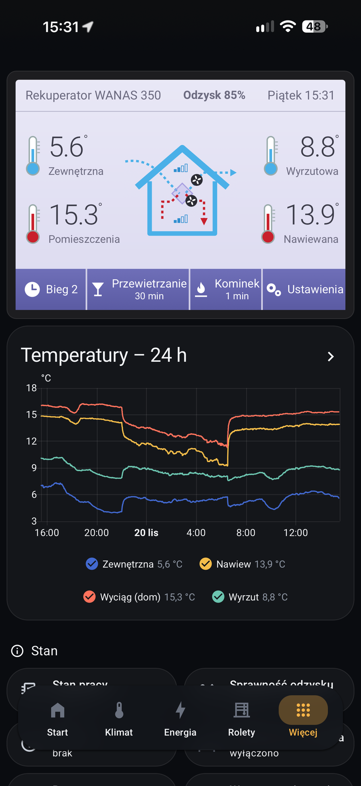
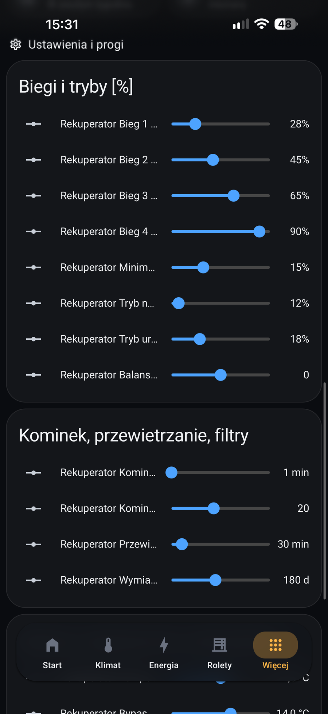
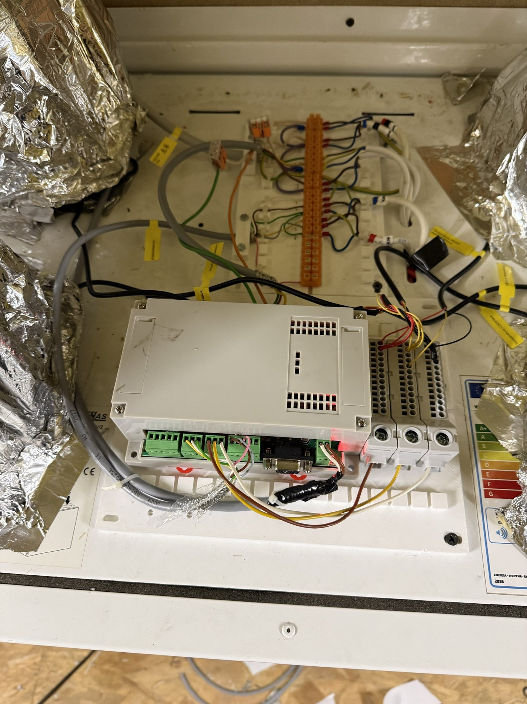

# Sterownik rekuperatora na ESP32 (ESPHome + Home Assistant)

Zamiennik fabrycznej płytki do rekuperatora **WANAS 350 V/2** zbudowany na **KinCony KC868-A4** z ESPHome.

Skąd to się wzięło? Fabrycznego sterownika nie dało się sensownie spiąć z Home Assistant, a potem jego płytka po prostu padła. Nowa od producenta jest droga i dalej nie gada z HA. Zrobiłem więc własny sterownik. Może się komuś przyda, jeśli ma podobny problem, także z innym rekuperatorem na wentylatorach EC 0–10 V.

<p align="center">
  
  
  
</p>

<p align="center">
  
</p>

> ⚠️ **Uwaga:** to praca przy 230 V, a w środku jest nagrzewnica. Jeśli nie czujesz się pewnie, podłączenie zostaw elektrykowi. Gwarancja na centralę oczywiście przepada. Robisz to na własną odpowiedzialność.

---

## Komponenty

| Element | Ilość | Uwagi |
|---|---|---|
| KinCony KC868-A4 (ESP32, 4 przekaźniki, 2× 0–10 V, 4 DI) | 1 | zasilanie 12 V DC |
| Zasilacz 12 V DC na DIN (np. Mean Well HDR-15-12) | 1 | |
| Czujnik DS18B20 w tulejce nierdzewnej, wodoodporny | 5 (+1 zapas) | jedna magistrala 1-Wire |
| Obudowa / skrzynka na DIN | 1 | |
| Listwy zaciskowe (np. BRX), kostki, wyłączniki nadprądowe | – | wg schematu |
| Przycisk monostabilny „Kominek” | 1 | opcja |

Wentylatory i nagrzewnica zostają oryginalne, z rekuperatora. Koszt części to orientacyjnie 400–600 zł.

## Podłączenie

| Zacisk KC868-A4 | GPIO | Co podłączone |
|---|---|---|
| DAC1 (AO1) | GPIO25 | wentylator nawiewny, sygnał 0–10 V |
| DAC2 (AO2) | GPIO26 | wentylator wywiewny, sygnał 0–10 V |
| K1 | GPIO2 | nagrzewnica wstępna 500 W (zacisk WANAS „N_PIERWOTNA”), włącz/wyłącz |
| K3 | GPIO5 | siłownik bypassu 3-punktowy 230 V (NO = otwórz, NC = zamknij) |
| DI1 | GPIO36 | tacho wentylatora nawiewnego (przewód SIG) |
| DI2 | GPIO39 | tacho wentylatora wywiewnego (przewód SIG) |
| DI4 | GPIO14 | przycisk Kominek |
| 1-Wire | GPIO13 | 5× DS18B20 |

Czujniki temperatury: zewnętrzna (czerpnia przed nagrzewnicą), wlot centrali, nawiew za wymiennikiem, wyciąg z domu, wyrzut.

Wentylatory mają stałe zasilanie przez własne wyłączniki, a zatrzymuje je sygnał 0 V. KC868-A4 daje maksymalnie ok. 9,5 V zamiast 10 V, ale w praktyce wentylatorom to wystarcza.

## Jak działa program

Program to plik ESPHome `esphome/wanas350.yaml` plus mały plik pomocniczy `esphome/wanas350_czas.h` (licznik czasu bez przepełnienia), który musi leżeć obok niego. Logika chodzi **na samym ESP32**, więc jak HA padnie, rekuperator dalej pracuje normalnie. Bez HA przez ponad 10 minut sterownik sam przechodzi w tryb nocny w godzinach 22–6, korzystając z zegara SNTP.

- **co 1 s:** wylicza wydajność wentylatorów z trybu i biegu, robi płynną rampę, pilnuje odmrażania i nagrzewnicy
- **rzadziej:** bypass, licznik filtrów, alarmy
- **nastawy** (biegi, progi, balans) zapisują się w pamięci ESP i przetrwają restart
- **aktualizacje** idą przez Wi-Fi (OTA). Bez Wi-Fi płytka wystawia własny hotspot `wanas350-awaryjny`, a w sieci ma też stronę www.

## Co potrafi

- biegi 1–4, tryb nocny, urlop, wyłączony
- **Kominek**: kilka minut lekkiego nadciśnienia (więcej nawiewu, mniej wywiewu)
- **Przewietrzanie**: chwilowo bieg 4
- **automatyczny bypass** latem: otwiera, gdy w domu jest cieplej niż temperatura komfortu, a na zewnątrz chłodniej. Temperaturę domu bierze z HA (`sensor.temperatura_pietro_srednia` w `wanas350.yaml` – podmień na swój czujnik), a bez HA z czujnika wyciągu
- **odmrażanie wymiennika**: najpierw nagrzewnica, a jak nie daje rady, przydławia nawiew
- nagrzewnica grzeje tylko przy pracującym nawiewie (sprawdzane tacho, więc tacho musi być podłączone, a „Kontrola obrotów” włączona)
- **zabezpieczenia nagrzewnicy**: gdy temperatura za nagrzewnicą (T_CZE) przekroczy nastawę (domyślnie 40 °C), K1 się wyłącza i zostaje zablokowany do ręcznego skasowania przyciskiem „Nagrzewnica – skasuj blokadę przegrzania” (blokada przetrwa restart); po ciągłej pracy dłuższej niż nastawa (domyślnie 60 min) robi 10 min przerwy; bez odczytu T_CZE nie grzeje wcale. Gdy nagrzewnica jest zablokowana albo ma przerwę, odmrażanie działa dławieniem nawiewu
- balans nawiew/wywiew do korekty po pomiarze anemometrem
- licznik dni pracy filtrów z przypomnieniem i resetem
- alarmy: czujniki, wentylatory (brak obrotów), ryzyko zamarzania, przegrzanie nagrzewnicy, filtry
- **tryb testowy**: ręczne ustawianie wentylatorów przy uruchamianiu

> 🔥 **Nagrzewnica** jest załączana bezpośrednio przekaźnikiem K1, tak samo jak w fabrycznej płytce. Zabezpieczenie (przegrzanie, limit czasu pracy) jest tylko w programie. Sprawdź, czy Twoja nagrzewnica ma wbudowany termik przegrzewowy. Jeśli nie ma, warto dołożyć szeregowo bimetal NC z ręcznym resetem.

## Encje w Home Assistant

| Encja | Typ |
|---|---|
| Tryb pracy (Bieg 1–4, Nocny, Urlop, Wyłączony) | select |
| Bypass – tryb (Auto / Otwarty / Zamknięty) | select |
| Kominek, Przewietrzanie, Zakończ tryb czasowy, Reset licznika filtrów | button |
| T zewnętrzna, T czerpnia, T nawiew, T wyciąg, T wyrzut | sensor °C |
| Wysterowanie nawiew / wywiew | sensor % |
| Obroty nawiew / wywiew | sensor obr/min |
| Sprawność odzysku | sensor % |
| Filtry – dni pracy | sensor |
| Bypass otwarty, Filtry do wymiany, Alarm, Status sterownika | binary_sensor |
| Stan pracy, Aktywne alarmy | text_sensor |
| Biegi 1–4, temperatura komfortu, progi odmrażania, minimalne wysterowanie, balans, wymiana filtrów co X dni… | number (konfiguracja) |
| Tryb testowy, Kontrola obrotów (tacho) | switch (konfiguracja) |

Zrzuty ekranu są na górze strony i w katalogu [`docs/`](docs/).

## Instalacja

📘 **Dokładna instrukcja wgrywania z rozwiązaniami problemów (CH340, przyciski BOOT/RESET): [`docs/wgrywanie.md`](docs/wgrywanie.md)**

W skrócie:

1. W HA zainstaluj dodatek **ESPHome Device Builder**.
2. W ESPHome → ⋮ → **Secrets** wklej zawartość `esphome/secrets.example.yaml` i uzupełnij swoje dane.
3. **+ New device** → nazwa `wanas350` → ESP32 → Skip. Potem **Edit**, wklej `esphome/wanas350.yaml` i zrób **Validate**.
4. Pierwsze wgranie przez USB: **Install → Manual download → Factory format**, a potem [web.esphome.io](https://web.esphome.io) w Chrome/Edge. Jak się nie łączy: trzymaj S2 (BOOT), kliknij S1 (RESET), puść S2 i dopiero wtedy Connect.
5. Po starcie odczytaj w logach adresy DS18B20 i wpisz je w `substitutions`. Który czujnik jest który, sprawdzisz, ogrzewając je po kolei dłonią.
6. Na koniec sprawdź trzy rzeczy: czy DAC1 to na pewno nawiew (jeśli nie, zamień GPIO25/26), w którą stronę rusza bypass (jeśli odwrotnie, zamień NO/NC na K3) i czy obroty z tacho wychodzą sensowne.

Przykładowy prosty harmonogram nocny jest w [`homeassistant/rekuperator_noc.yaml`](homeassistant/rekuperator_noc.yaml). Pełniejsza automatyka jest w pakietach (niżej).

Karta z panelu na zrzutach (schemat domu z temperaturami i przyciskami) to [`homeassistant/rekuperator-card.js`](homeassistant/rekuperator-card.js): wrzuć ją do `/config/www/` i dodaj jako zasób `/local/rekuperator-card.js`.

Cały widok „Rekuperator” z tych zrzutów (karta, wykres temperatur, stan, sterowanie, ustawienia) jest w [`homeassistant/rekuperator_widok.yaml`](homeassistant/rekuperator_widok.yaml) – wklej go w edytorze kodu dashboardu jako kolejny element `views:`.

## Pakiety Home Assistant

W katalogu [`homeassistant/packages/`](homeassistant/packages/) są gotowe pakiety. Wrzuć je do `/config/packages/` i włącz pakiety w `configuration.yaml`:

```yaml
homeassistant:
  packages: !include_dir_named packages
```

| Pakiet | Co robi |
|---|---|
| `rekuperator_harmonogram.yaml` | tryb dzień/noc wg pomocnika `schedule.rekuperator_noc`; nie rusza Urlop/Wyłączony, Przewietrzania i Kominka; pomija zmianę, gdy trwa podbicie z wilgoci (zastępuje `rekuperator_noc.yaml`) |
| `rekuperator_nieobecnosc.yaml` | nikogo w domu 3 h → Urlop, po powrocie tryb z harmonogramu (wymaga `binary_sensor.ktos_w_domu`) |
| `rekuperator_alert.yaml` | powiadomienia (rekuperator stoi, alarmy sterownika) i **awaryjne wyłączenie gniazdka** przy kłopocie z nagrzewnicą |
| `rekuperator_wilgotnosc.yaml` | podbicie biegu przy wilgoci w wyciągu (opis niżej) |

Wymagania wspólne: powiadomienia idą przez `script.powiadomienie` (u mnie Telegram – zrób własny skrypt z polami `title` i `message`), a pakiet alertów zakłada gniazdko z pomiarem mocy `switch.rekuperator_gniazdo` / `sensor.rekuperator_gniazdo_power`, z którego zasilany jest rekuperator.

**Awaryjne wyłączenie gniazdka** to druga, niezależna od ESP warstwa ochrony nagrzewnicy 500 W. Wyłącza gniazdko (cały rekuperator), gdy:
- pobór > 300 W przez 1 min, a sterownik mówi, że K1 jest wyłączony albo jest niedostępny (sklejony przekaźnik, zawieszony ESP),
- pobór > 300 W dłużej niż 75 min (limit sterownika 60 min nie zadziałał),
- T czerpni > 55 °C przez 1 min (limit sterownika 40 °C nie zadziałał).

Gniazdko zostaje wyłączone, włączasz je ręcznie po sprawdzeniu centrali.

## Czujnik wilgotności wyciągu

Osobny NodeMCU v3 (ESP8266) z czujnikiem SHT3x w skrzynce rozprężnej wyciągów: [`esphome/wanas-wilgotnosc.yaml`](esphome/wanas-wilgotnosc.yaml). Odczyt idzie przez Wi-Fi do HA, a pakiet `rekuperator_wilgotnosc.yaml` podbija bieg. Gdy czujnik padnie, rekuperator pracuje normalnie, tylko bez podbijania.

| SHT3x | NodeMCU |
|---|---|
| VIN / VCC | 3V3 |
| GND | GND |
| SDA | D2 (GPIO4) |
| SCL | D1 (GPIO5) |

Adres I2C 0x44 (0x45, gdy ADR jest podpięty do VCC), magistrala 50 kHz, przewody jak najkrótsze (do ~1 m). Zasilanie 5 V przez micro-USB. Pierwsze wgranie przez USB (sterownik CH340), potem OTA. Plik używa tych samych sekretów co `wanas350`.

Encje: temperatura, wilgotność, punkt rosy, wilgotność bezwzględna, sygnał Wi-Fi, BSSID, czas uruchomienia, przycisk restartu. Nazw „Wilgotność” i „Punkt rosy” nie zmieniaj, bo korzysta z nich pakiet.

**Jak działa podbicie:**
- „wilgoć podwyższona”, gdy wilgotność ≥ próg (85 %) **albo** wzrosła o skok (8 pkt) ponad minimum z ostatnich 2 h; wyłącza się z histerezą (5 pkt poniżej progu i wzrost < połowy skoku),
- bieg tylko w górę: w dzień Bieg 3, w nocy Bieg 2; nie rusza Urlop, Wyłączony, Przewietrzania i Kominka,
- powrót do trybu z harmonogramu po 10 min bez wilgoci albo po maks. czasie (90 min); gdy harmonogram jest wyłączony – do trybu sprzed podbicia,
- ręczna zmiana trybu kończy podbicie bez cofania,
- powiadomienie, gdy czujnik jest offline 30 min,
- dodatkowy sensor „zapas nad punktem rosy” (T wyrzutu − punkt rosy powietrza z domu); wartość ujemna = w wymienniku skrapla się woda.

**Pierwsza konfiguracja:** po wgraniu pakietu ustaw w pomocnikach: skok 8 pkt, próg 85 %, maks. czas 90 min, bieg przy wilgoci dzień = Bieg 3, noc = Bieg 2, i dopiero wtedy włącz „Rekuperator – podbijanie biegu przy wilgoci”. Pomocniki nie mają wartości `initial`, żeby zmiany z interfejsu przetrwały restart – przy pierwszym starcie przyjmują minimum zakresu.

**Strojenie:** w skrzynce jest ok. 15–17 °C, więc wilgotność względna jest tam wyższa niż w pokojach (21 °C / 45 % w pokoju ≈ 65 % w skrzynce). Dlatego główne kryterium to skok, a próg bezwzględny jest wysoki. Jeśli podbicie łapie się za często, zwiększ skok (10–12); jeśli nie reaguje na prysznic, zmniejsz go (5–6).

## Karta Lovelace

[`homeassistant/rekuperator-card.js`](homeassistant/rekuperator-card.js) (wersja 5). Klucze w `entities`:

| Klucz | Encja |
|---|---|
| `t_out`, `t_room`, `t_exh`, `t_sup` | temperatury |
| `mode`, `bypass_mode` | select: tryb pracy, tryb bypassu |
| `state`, `alarm` | stan pracy, aktywne alarmy |
| `duty`, `duty_exh`, `rpm_sup`, `rpm_exh`, `eff` | wysterowanie, obroty, sprawność |
| `party_btn`, `party_min`, `party_left` | Przewietrzanie: przycisk, czas, pozostało |
| `fire_btn`, `fire_min`, `fire_left` | Kominek: j.w. |
| `stop_btn` | zakończ tryb czasowy |
| `heater` | binary_sensor nagrzewnica pracuje – grzałka na wlocie świeci i paruje |
| `bypass` | binary_sensor bypass otwarty – zielona ścieżka omijająca wymiennik |
| `rh_room` | wilgotność wyciągu (linia pod „Pomieszczenia”) |
| `rh_boost` | input_boolean podbicie z wilgoci trwa – strzałka „↑” |

Przykład:

```yaml
type: custom:rekuperator-card
title: Rekuperator WANAS 350
entities:
  t_out: sensor.rekuperator_t_zewnetrzna_przed_nagrzewnica
  t_room: sensor.rekuperator_t_wyciag_dom
  t_exh: sensor.rekuperator_t_wyrzut
  t_sup: sensor.rekuperator_t_nawiew
  mode: select.rekuperator_tryb_pracy
  bypass_mode: select.rekuperator_bypass_tryb
  state: sensor.rekuperator_stan_pracy
  alarm: sensor.rekuperator_aktywne_alarmy
  heater: binary_sensor.rekuperator_nagrzewnica_wstepna_pracuje
  bypass: binary_sensor.rekuperator_bypass_otwarty
  rh_room: sensor.rekuperator_wyciag_wilgotnosc
  rh_boost: input_boolean.rekuperator_wilgoc_aktywne
```

Pełny przykład z wszystkimi kluczami jest w `rekuperator_widok.yaml`.

## Znane ograniczenia

- **Czujniki T_ZEW i T_CZE stoją przed nagrzewnicą.** Test z 23.11.2026 pokazał, że oba mierzą powietrze zanim dotrze do grzałki, więc programowa blokada przegrzania (T_CZE > 40 °C) praktycznie nie zobaczy przegrzania samej nagrzewnicy. Zalecane: dołożyć DS18B20 **za** nagrzewnicą i/lub termik bimetaliczny NC 70 °C z ręcznym resetem (np. KSD301) szeregowo w obwodzie grzałki. Do tego czasu drugą warstwą ochrony jest awaryjne wyłączenie gniazdka z pakietu alertów.
- T_ZEW ma w programie korektę −4,3 °C (czujnik zawyżał).
- Czujnik wilgotności w skrzynce wyciągu mierzy w chłodniejszym powietrzu niż w pokojach (patrz strojenie wyżej).

## Druk 3D

Części, które wydrukowałem do montażu w rekuperatorze (katalog [`stl/`](stl/)):

| Plik | Co to jest |
|---|---|
| `wanas_podstawka_sterownika.stl` | płyta pod KC868-A4 w obudowie DIN i bloki 1-Wire, w miejsce fabrycznej płytki (odcinek szyny TH35 przykręcany M3 z nakrętkami wsuwanymi w rowek) |
| `wanas_docisk_3x8mm.stl` | docisk na 3 kable 230 V (Ø ok. 8 mm) |
| `wanas_docisk_1x6mm.stl` | docisk na kabel sygnałowy 12 V (Ø ok. 6 mm) |

Widać je na zdjęciu skrzynki wyżej. Zanim wydrukujesz, sprawdź wymiary swojej obudowy sterownika.

## Licencja

MIT. Korzystaj, przerabiaj, a jak coś poprawisz, wrzuć PR 🙂
