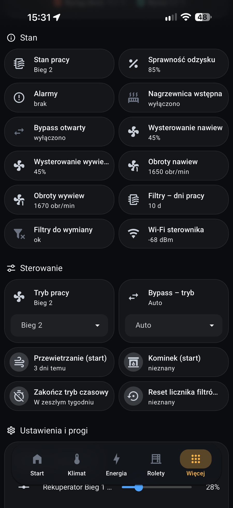

# Sterownik rekuperatora na ESP32 (ESPHome + Home Assistant)

Zamiennik fabrycznej płytki do rekuperatora **WANAS 350 V/2** zbudowany na **KinCony KC868-A4** z ESPHome.

Skąd to się wzięło? Fabrycznego sterownika nie dało się sensownie spiąć z Home Assistant, a potem jego płytka po prostu padła. Nowa od producenta jest droga i dalej nie gada z HA. Zrobiłem więc własny sterownik. Może się komuś przyda, jeśli ma podobny problem, także z innym rekuperatorem na wentylatorach EC 0–10 V.

  
  
  

  

> ⚠️ **Uwaga:** to praca przy 230 V, a w środku jest nagrzewnica. Jeśli nie czujesz się pewnie, podłączenie zostaw elektrykowi. Gwarancja na centralę oczywiście przepada. Robisz to na własną odpowiedzialność.

---

## Komponenty

| Element | Ilość | Uwagi |
|---|---|---|
| KinCony KC868-A4 (ESP32, 4 przekaźniki, 2× 0–10 V, 4 DI) | 1 | zasilanie 12 V DC |
| Zasilacz 12 V DC na DIN (np. Mean Well HDR-15-12) | 1 | |
| Czujnik DS18B20 w tulejce nierdzewnej, wodoodporny | 5 (+1 zapas) | jedna magistrala 1-Wire |
| Obudowa / skrzynka na DIN | 1 | |
| Listwy zaciskowe (np. BRX), kostki, wyłączniki nadprądowe | – | wg schematu |
| Przycisk monostabilny „Kominek” | 1 | opcja |

Wentylatory i nagrzewnica zostają oryginalne, z rekuperatora. Koszt części to orientacyjnie 400–600 zł.

## Podłączenie

| Zacisk KC868-A4 | GPIO | Co podłączone |
|---|---|---|
| DAC1 (AO1) | GPIO25 | wentylator nawiewny, sygnał 0–10 V |
| DAC2 (AO2) | GPIO26 | wentylator wywiewny, sygnał 0–10 V |
| K1 | GPIO2 | nagrzewnica wstępna 500 W (zacisk WANAS „N_PIERWOTNA”), włącz/wyłącz |
| K3 | GPIO5 | siłownik bypassu 3-punktowy 230 V (NO = otwórz, NC = zamknij) |
| DI1 | GPIO36 | tacho wentylatora nawiewnego (przewód SIG) |
| DI2 | GPIO39 | tacho wentylatora wywiewnego (przewód SIG) |
| DI4 | GPIO14 | przycisk Kominek |
| 1-Wire | GPIO13 | 5× DS18B20 |

Czujniki temperatury: zewnętrzna (czerpnia przed nagrzewnicą), wlot centrali, nawiew za wymiennikiem, wyciąg z domu, wyrzut.

Wentylatory mają stałe zasilanie przez własne wyłączniki, a zatrzymuje je sygnał 0 V. KC868-A4 daje maksymalnie ok. 9,5 V zamiast 10 V, ale w praktyce wentylatorom to wystarcza.

## Jak działa program

Program to plik ESPHome `esphome/wanas350.yaml` plus mały plik pomocniczy `esphome/wanas350_czas.h` (licznik czasu bez przepełnienia), który musi leżeć obok niego. Logika chodzi **na samym ESP32**, więc jak HA padnie, rekuperator dalej pracuje normalnie. Bez HA przez ponad 10 minut sterownik sam przechodzi w tryb nocny w godzinach 22–6, korzystając z zegara SNTP.

- **co 1 s:** wylicza wydajność wentylatorów z trybu i biegu, robi płynną rampę, pilnuje odmrażania i nagrzewnicy
- **rzadziej:** bypass, licznik filtrów, alarmy
- **nastawy** (biegi, progi, balans) zapisują się w pamięci ESP i przetrwają restart
- **aktualizacje** idą przez Wi-Fi (OTA). Bez Wi-Fi płytka wystawia własny hotspot `wanas350-awaryjny`, a w sieci ma też stronę www.

## Co potrafi

- biegi 1–4, tryb nocny, urlop, wyłączony
- **Kominek**: kilka minut lekkiego nadciśnienia (więcej nawiewu, mniej wywiewu)
- **Przewietrzanie**: chwilowo bieg 4
- **automatyczny bypass** latem: otwiera, gdy w domu jest cieplej niż temperatura komfortu, a na zewnątrz chłodniej. Temperaturę domu bierze z HA (`sensor.temperatura_pietro_srednia` w `wanas350.yaml` – podmień na swój czujnik), a bez HA z czujnika wyciągu
- **odmrażanie wymiennika**: najpierw nagrzewnica, a jak nie daje rady, przydławia nawiew
- nagrzewnica grzeje tylko przy pracującym nawiewie (sprawdzane tacho, więc tacho musi być podłączone, a „Kontrola obrotów” włączona)
- balans nawiew/wywiew do korekty po pomiarze anemometrem
- licznik dni pracy filtrów z przypomnieniem i resetem
- alarmy: czujniki, wentylatory (brak obrotów), ryzyko zamarzania, filtry
- **tryb testowy**: ręczne ustawianie wentylatorów przy uruchamianiu

> 🔥 **Nagrzewnica** jest załączana bezpośrednio przekaźnikiem K1, tak samo jak w fabrycznej płytce. Zabezpieczenie jest tylko w programie. Sprawdź, czy Twoja nagrzewnica ma wbudowany termik przegrzewowy. Jeśli nie ma, warto dołożyć szeregowo bimetal NC z ręcznym resetem.

## Encje w Home Assistant

| Encja | Typ |
|---|---|
| Tryb pracy (Bieg 1–4, Nocny, Urlop, Wyłączony) | select |
| Bypass – tryb (Auto / Otwarty / Zamknięty) | select |
| Kominek, Przewietrzanie, Zakończ tryb czasowy, Reset licznika filtrów | button |
| T zewnętrzna, T czerpnia, T nawiew, T wyciąg, T wyrzut | sensor °C |
| Wysterowanie nawiew / wywiew | sensor % |
| Obroty nawiew / wywiew | sensor obr/min |
| Sprawność odzysku | sensor % |
| Filtry – dni pracy | sensor |
| Bypass otwarty, Filtry do wymiany, Alarm, Status sterownika | binary_sensor |
| Stan pracy, Aktywne alarmy | text_sensor |
| Biegi 1–4, temperatura komfortu, progi odmrażania, minimalne wysterowanie, balans, wymiana filtrów co X dni… | number (konfiguracja) |
| Tryb testowy, Kontrola obrotów (tacho) | switch (konfiguracja) |

Zrzuty ekranu są na górze strony i w katalogu [`docs/`](docs/).

## Instalacja

📘 **Dokładna instrukcja wgrywania z rozwiązaniami problemów (CH340, przyciski BOOT/RESET): [`docs/wgrywanie.md`](docs/wgrywanie.md)**

W skrócie:

1. W HA zainstaluj dodatek **ESPHome Device Builder**.
2. W ESPHome → ⋮ → **Secrets** wklej zawartość `esphome/secrets.example.yaml` i uzupełnij swoje dane.
3. **+ New device** → nazwa `wanas350` → ESP32 → Skip. Potem **Edit**, wklej `esphome/wanas350.yaml` i zrób **Validate**.
4. Pierwsze wgranie przez USB: **Install → Manual download → Factory format**, a potem [web.esphome.io](https://web.esphome.io) w Chrome/Edge. Jak się nie łączy: trzymaj S2 (BOOT), kliknij S1 (RESET), puść S2 i dopiero wtedy Connect.
5. Po starcie odczytaj w logach adresy DS18B20 i wpisz je w `substitutions`. Który czujnik jest który, sprawdzisz, ogrzewając je po kolei dłonią.
6. Na koniec sprawdź trzy rzeczy: czy DAC1 to na pewno nawiew (jeśli nie, zamień GPIO25/26), w którą stronę rusza bypass (jeśli odwrotnie, zamień NO/NC na K3) i czy obroty z tacho wychodzą sensowne.

Przykładowy harmonogram nocny jest w [`homeassistant/rekuperator_noc.yaml`](homeassistant/rekuperator_noc.yaml).

Karta z panelu na zrzutach (schemat domu z temperaturami i przyciskami) to [`homeassistant/rekuperator-card.js`](homeassistant/rekuperator-card.js): wrzuć ją do `/config/www/` i dodaj jako zasób `/local/rekuperator-card.js`.

## Druk 3D

Części, które wydrukowałem do montażu w rekuperatorze (katalog [`stl/`](stl/)):

| Plik | Co to jest |
|---|---|
| `wanas_podstawka_sterownika.stl` | płyta pod KC868-A4 w obudowie DIN i bloki 1-Wire, w miejsce fabrycznej płytki (odcinek szyny TH35 przykręcany M3 z nakrętkami wsuwanymi w rowek) |
| `wanas_docisk_3x8mm.stl` | docisk na 3 kable 230 V (Ø ok. 8 mm) |
| `wanas_docisk_1x6mm.stl` | docisk na kabel sygnałowy 12 V (Ø ok. 6 mm) |

Widać je na zdjęciu skrzynki wyżej. Zanim wydrukujesz, sprawdź wymiary swojej obudowy sterownika.

## Licencja

MIT. Korzystaj, przerabiaj, a jak coś poprawisz, wrzuć PR 🙂
